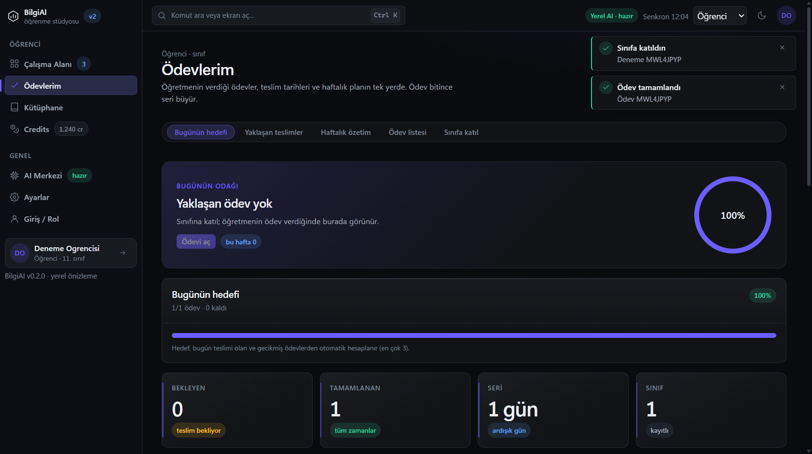
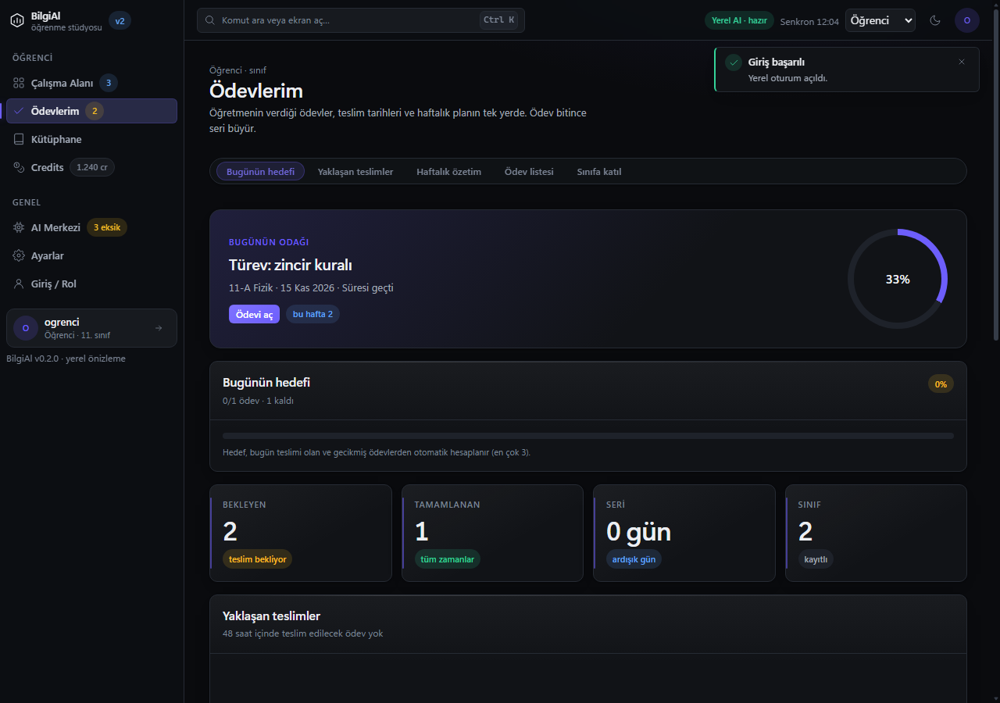
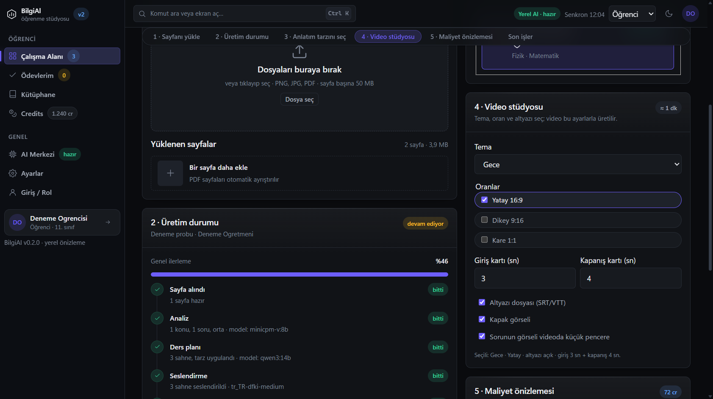
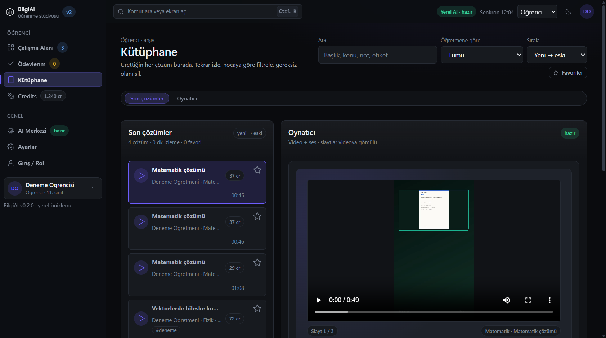
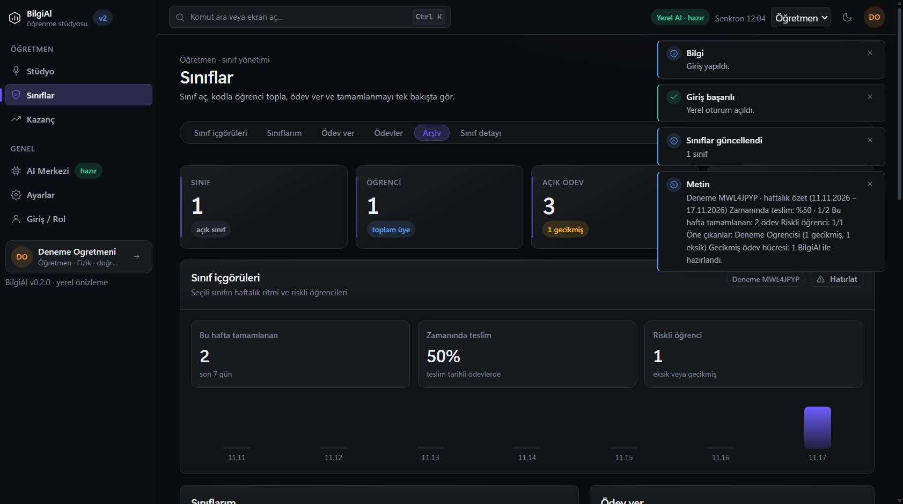
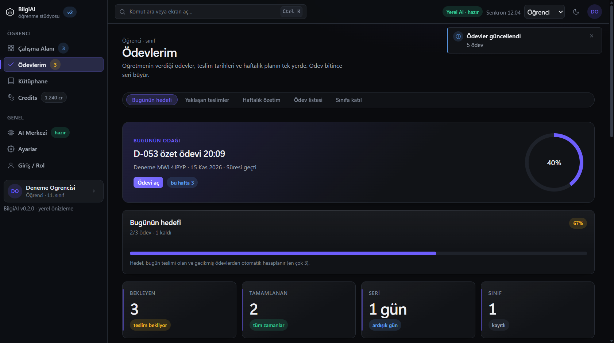
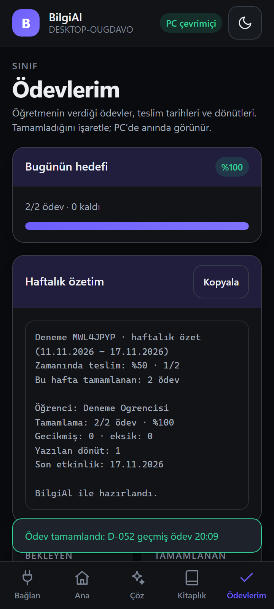
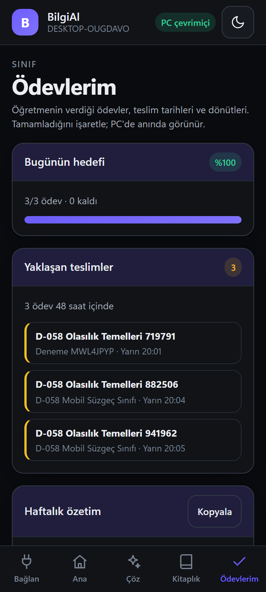
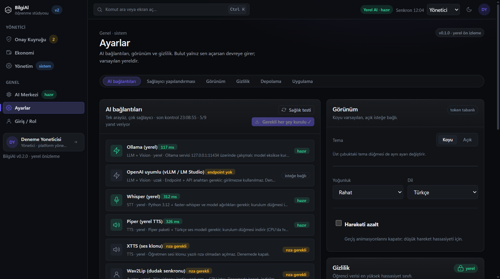
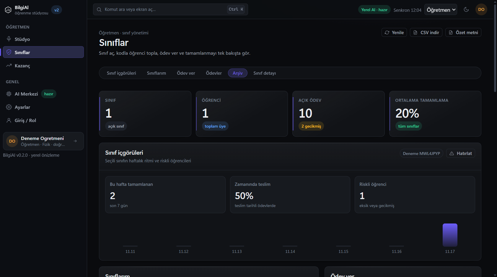

# BilgiAl

**Öğretmenin anlatım tarzını öğrenen, yerel çalışan yapay zekâ destekli ders üretim stüdyosu.**

BilgiAl; bir öğrencinin yüklediği soru sayfasını okur, seçilen öğretmenin anlatım tarzına göre
plan çıkarır, Türkçe seslendirme ve slaytlarla **ders videosu** üretir. Ardından o videoyu sınıf,
ödev, ilerleme ve dönüt akışına bağlar. Her şey **kendi bilgisayarında** çalışır: bulut yok,
abonelik yok, veri dışarı çıkmaz.

> **Durum:** `v0.2.0-deneme` — çalışan bir demo ve geliştirilmeye açık bir fikir.
> Kaynak kod açıktır, geri bildirim ve katkı beklenir.
> Hazır Windows paketi: [Releases](https://github.com/alibstm19/bilgial/releases) → `BilgiAl-0.2.0-deneme.zip`.

[](LICENSE)
[](#gereksinimler)
[](https://www.electronjs.org/)
[](#kalite-kapıları)
[](#mimari)

---

## Neden?

Özel ders pahalı, hazır video içerik kişiselleştirilmemiş. Öğrencinin takıldığı **tam o soru**
için, **kendi öğretmeninin anlatımıyla** bir açıklama üretmek bugün elle yapılan, saatler süren
bir iştir. BilgiAl bunu yerel modellerle dakikalara indirir:

| Bugün | BilgiAl ile |
|---|---|
| Öğrenci cevabı bulamıyor, öğretmene gece yazıyor | Soru fotoğrafı → dakikalar içinde sesli-görsel çözüm |
| Öğretmen her öğrenciye ayrı ayrı anlatıyor | Aynı anlatım tarzı, ölçeklenebilir üretim |
| Hazır videolar sınıfın seviyesine uymuyor | Sınıf, ödev ve ilerleme aynı panelde |
| Bulut araçları veriyi dışarı gönderiyor | Tamamen yerel: internet kapalıyken de çalışır |

**Hedef kitle:** özel ders veren öğretmenler, küçük kurslar, kendi hızında çalışan öğrenciler ve
okullarda pilot yapmak isteyen eğitim teknolojisi ekipleri.

---

## Öne çıkanlar

### 🎬 Çözüm üretimi
- **Soru → ders videosu:** görsel model sayfayı okur, metin modeli adım adım plan kurar.
- **Öğretmen tarzı:** eğitilen profilden ton, hız ve ayrıntı düzeyi (`styleVector`) uygulanır.
- **Türkçe seslendirme:** yerel **Piper** (`tr_TR-dfki-medium`) ile gerçek ses; model yoksa iş
  dürüstçe `partial` kalır, sessiz slayt üretilir.
- **Video stüdyosu (D-059):** 6 tema, **16:9 / 9:16 / 1:1**, giriş-kapanış kartı, altyazı
  (**SRT + VTT**), kapak görseli, resim-içinde-resim, bölüm listesi ve ilerleme çubuğu.
- **Canlı aşamalar:** oku → anla → planla → seslendir → birleştir → teslim; her adım ölçülür.

### 🏫 Sınıf ve ödev
- Öğretmen sınıf açar, **6 karakterlik katılım kodu** üretilir; öğrenci kodla katılır.
- Ödev verilir, öğrenci tamamlar; ilerleme **öğrenci × ödev** hücresi bazında tutulur.
- **İçgörüler:** haftalık ritim, zamanında teslim yüzdesi, riskli öğrenciler, **CSV dışa aktarma**
  (formül enjeksiyonuna karşı korumalı).
- **Dönüt ve hatırlatma:** öğretmen dönüt yazar; gecikmiş ödevler kopyalanabilir hatırlatma
  metnine dönüşür.
- **Haftalık özet:** öğretmen sınıfın, öğrenci yalnız kendi özetini görür — e-posta ve katılım
  kodu asla metne girmez.
- **Yaklaşan teslimler:** 48 saat içindeki ödevler kart + rozet; en fazla 6 saatte bir yerel
  bildirim.
- **Arşiv + geri alma**, Türkçe harf duyarsız **arama**, durum süzgeci ve sıralama.

### 📱 Telefon (aynı Wi-Fi)
- Masaüstündeki QR ile telefona bağlan; **kurulabilir PWA**, çevrimdışı kabuk.
- Öğrenci telefonda **Ödevlerim**: günlük hedef, ödev listesi, öğretmen dönütü, "Tamamla".
- Telefondan iş iptali ve kredi iadesi; çözüm bitince bildirim.

### 🧠 Yerel yapay zekâ
- **Ollama** üzerinden metin + görsel modeller; bulut varsayılan **kapalı**.
- Donanıma göre **kademeli model indirici**: `core` 21,5 GB → `quality` ~103 GB → `speech` → `heavy`.
- Tek düğmeyle eksik bileşen kurulumu, gerçek indirme yüzdesi, iptal.
- Model danışmanı: sığma/kalite/hız karşılaştırması, gerçek ölçüm.

### 🛡️ Dürüstlük ve etik kapılar
- Ses klonlama (XTTS) ve avatar/dudak senkronu (Wav2Lip/SadTalker) **yazılı rıza olmadan
  açılmaz**; tek indirme düğmesi bu konektörleri listelemez.
- Gerçek ödeme yok; kredi satın alma **simülasyondur** (`paymentMode: "simulated"`).
- Durum rozetleri gerçeği söyler: "hazır" değilse "hazır" yazmaz.

---

## Ekran görüntüleri

| Sınıflar ve ödevler | Sınıf içgörüleri |
|---|---|
|  |  |

| Video stüdyosu | Kitaplık oynatıcı |
|---|---|
|  |  |

| Haftalık özet | Yaklaşan teslimler |
|---|---|
|  |  |

| Telefonda Ödevlerim | Telefonda arama ve süzgeç |
|---|---|
|  |  |

| AI kurulum ve konektörler | Ödev arama / sıralama |
|---|---|
|  |  |

---

## Mimari

```
┌──────────────────────────────────────────────────────────────────┐
│ Electron ana proses (Node.js)                                    │
│                                                                  │
│  main.js ── 92 IPC kanalı ── preload (contextBridge)             │
│     │                                                            │
│     ├── services/classes.js ──── sınıf, ödev, dönüt, içgörü      │
│     ├── services/jobs.js ─────── iş kuyruğu, kredi, iptal        │
│     ├── services/library.js ──── artefakt, video, altyazı, kapak │
│     ├── services/ai/ ─────────── ollama, piper, whisper, compose │
│     ├── services/ai/video.js ─── video motoru (saf, bağımlılıksız)│
│     ├── services/mobile-server.js ─ LAN HTTP + PWA + /api/media  │
│     └── services/store.js ────── JSON belgeleri + şema kapıları  │
│                                                                  │
├── src/renderer  (masaüstü arayüz: düz HTML/CSS/JS)               │
├── src/web       (telefon arayüzü: PWA + service worker)          │
└── src/shared    (tek doğruluk kaynağı: model, şema, sözleşme)     │
```

- **Çalışma zamanı bağımlılığı yok.** Electron dışında hiçbir npm paketi kullanılmaz; ses/video
  işleri yerel araçlarla (`piper`, `ffmpeg`, `whisper`) yapılır.
- **Tek doğruluk kaynağı:** iş kuralları `src/shared/*` içinde; servisler ve arayüz aynı modeli
  kullanır.
- **Sözleşme testi:** her IPC kanalı `docs/contract-v0.md` §5 ile birebir eşleşmek zorunda.
- **Şema kapıları:** her yazma öncesi `schema.validate*`; bozuk belge diske yazılmaz.

Ayrıntı: [`docs/ai-mimari.md`](docs/ai-mimari.md) · [`docs/contract-v0.md`](docs/contract-v0.md) ·
[`docs/tasarim-dili.md`](docs/tasarim-dili.md) · 15 dakikalık tur: [`docs/demo-rehberi.md`](docs/demo-rehberi.md)

---

## Hızlı başlangıç

### A) Hazır Windows demosu (önerilen)

1. [Releases](https://github.com/alibstm19/bilgial/releases) sayfasından `BilgiAl-0.2.0-deneme.zip` dosyasını indir.
2. ZIP'i bir klasöre çıkar, `Baslat-Deneme.cmd` dosyasına çift tıkla.
3. Deneme hesaplarıyla gir:

   | Rol | E-posta | Parola |
   |---|---|---|
   | Öğrenci | `ogrenci@bilgial.local` | `BilgiAl2026` |
   | Öğretmen | `ogretmen@bilgial.local` | `BilgiAl2026` |
   | Yönetici | `admin@bilgial.local` | `BilgiAl2026` |

Paket; örnek ders videosu, sınıf/ödev verisi ve **63 MB Türkçe ses modeli** ile gelir.
Kurulum gerektirmez; kod imzalı olmadığı için Windows "Bilinmeyen yayıncı" uyarabilir.

> Ayrıntılı adım adım test: ZIP içindeki `KURULUM-VE-TEST.md` ve `OKU-BENI.txt`.

### B) Kaynaktan çalıştırma

```powershell
git clone https://github.com/alibstm19/bilgial.git
cd bilgial\src
npm install          # yalnızca Electron (tek devDependency)
npm start
```

Test ve kalite kapıları (depo kökünde):

```powershell
node --test tests/
node tools/lint.js
node tools/doctor.js
```

Windows paketi üretmek için:

```powershell
powershell -ExecutionPolicy Bypass -File tools/build.ps1
powershell -ExecutionPolicy Bypass -File tools/package.ps1
```

---

## Gereksinimler

| Bileşen | Zorunlu? | Not |
|---|---|---|
| Windows 10/11 | ✅ | Masaüstü uygulaması |
| Node.js ≥ 18 | Kaynaktan çalıştırırken | Bu projede Node 26 ile ölçüldü |
| [Ollama](https://ollama.com) + model | ✅ (üretim için) | `qwen3:14b` (metin), `minicpm-v:8b` (görsel) |
| Piper + Türkçe ses modeli | Ses için | Demo ZIP'te `tr_TR-dfki-medium` gelir; `python -m pip install piper-tts` |
| FFmpeg | Video birleştirme | Yoksa slayt videosu üretilir |
| faster-whisper | Transkript | İsteğe bağlı |
| Python 3.10+ | Ses/transkript | Piper ve Whisper için |

Model setini donanıma göre tek komutla indir:

```powershell
node tools/models-pull.js --dry-run              # plan ve disk kontrolü
node tools/models-pull.js --yes                  # core (21,5 GB)
node tools/models-pull.js --tier=quality --yes   # kalite kademesi
```

---

## Kalite kapıları

Bu depodaki son ölçüm (2026-11-25):

```
node --test tests/    -> 300 test, 300 pass, 0 fail
node tools/lint.js    -> 0 hata, 0 uyarı  (6 CSS · 2 HTML · 65 JS)
node tools/doctor.js  -> 0 hata, 0 uyarı
```

- **Lint kuralları:** `tokens.css` dışında ham renk yok, `!important` yok, inline `style` yok,
  sözleşme §6 kimlikleri eksiksiz, `.env`/sır literali yok.
- **Sözleşme testi:** kanal sayısı ve listesi `docs/contract-v0.md` §5 + §7.2 ile birebir.
- **Saha ölçümleri:** her özellik gerçek Electron + CDP ve gerçek telefon köprüsüyle ölçülür;
  taşma 0, konsol hatası 0 kabul eşiğidir.
- **Uçtan uca deneme:** `tools/trial.ps1` gerçek veriyle uygulamayı açar; `tools/package.ps1`
  aynı veriyi ve Türkçe ses modelini taşınabilir ZIP'e paketler.

---

## Bilinen sınırlar (bilinçli)

- **Gerçek ödeme yok.** Kredi satın alma simülasyondur; muhasebe kaydı bunu açıkça yazar.
- **Ses klonlama ve avatar yok.** XTTS, Wav2Lip ve SadTalker yazılı rıza (`consent.json`)
  olmadan çalışmaz; demo bunları indirmez.
- **Bulut kapalı.** OpenAI uyumlu sağlayıcı yalnız kullanıcı anahtar girerse ve açıkça açarsa
  çalışır.
- **Tek makine.** Sınıf verisi yerel JSON belgelerinde tutulur; çok kullanıcılı sunucu sürümü
  yol haritasındadır.
- **Kod imzası yok.** Windows SmartScreen uyarısı normaldir.

---

## Yol haritası — bu fikri birlikte büyütelim

- [ ] Çok kullanıcılı sunucu modu (okul/ kurs) + rol bazlı yetkilendirme
- [ ] Öğretmen onay akışı ve kalite puanlama
- [ ] Gerçek STT ile video derslerden otomatik transkript ve tarz çıkarımı
- [ ] Rıza yönetimi tamamlanınca ses klonlama ve avatar
- [ ] Altyazı çevirisi ve çok dilli ders üretimi
- [ ] iOS/Android yerel istemci (bugün PWA)
- [ ] LTI / Google Classroom köprüsü
- [ ] Erişilebilirlik: ekran okuyucu ve klavye ile tam gezinme

Fikirlerinizi [Issues](https://github.com/alibstm19/bilgial/issues) altında açabilirsiniz. Hangi özelliğin gerçekten işe
yaradığını sahadan öğrenmek istiyoruz.

---

## Katkı

Katkılar açıktır. Küçük ve ölçülebilir değişiklikler tercih edilir:

1. Depoyu çatalla, anlamlı bir dal aç.
2. `node --test tests/`, `node tools/lint.js`, `node tools/doctor.js` yeşil olsun.
3. Yeni davranış için test ekle; kullanıcıya görünen metin Türkçe, kod/dosya/commit İngilizce.
4. Pull request açıklamasında **ölçüm** ver (komut + çıktı ya da ekran görüntüsü).

Yeni bir çalışma zamanı bağımlılığı eklemeyin: proje bilinçli olarak "sıfır runtime dependency"
politikasıyla geliştiriliyor.

---

## Gizlilik

BilgiAl veriyi cihazda tutar. Ağ erişimi yalnızca iki yerdedir: `127.0.0.1:11434` (Ollama) ve
isteğe bağlı LAN telefon köprüsü (`:4780`). Telefon köprüsü eşleştirme kodu ister ve yalnız aynı
Wi-Fi ağında çalışır. Depoda sır, anahtar veya kişisel veri bulunmaz; demo hesapları kurgusaldır.

---

## Lisans

Kod **MIT** lisansıyla yayınlanmıştır — bkz. [LICENSE](LICENSE). Üçüncü taraf bileşenler kendi
lisanslarını korur (Electron, Piper ses modeli, FFmpeg). Demo paketindeki `LICENSES.chromium.html`
Electron/Chromium lisanslarını içerir.

---

## English summary

**BilgiAl** is a local-first, AI-assisted lesson studio for Windows. A student uploads a photo of
a question; BilgiAl reads it, plans a step-by-step explanation in a chosen teacher's style,
narrates it in Turkish with a local Piper voice, and renders a captioned lesson video — then
connects it to classes, assignments, progress, feedback and a phone-friendly PWA over the LAN.
Everything runs on-device; no cloud, no subscription, no data leaves the machine. This repository
is a working demo (`v0.2.0`) and an open idea: feedback and contributions are welcome.
MIT licensed.
